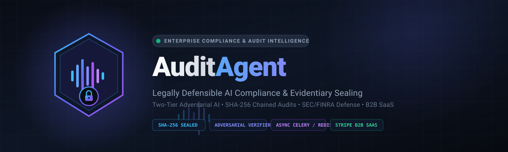
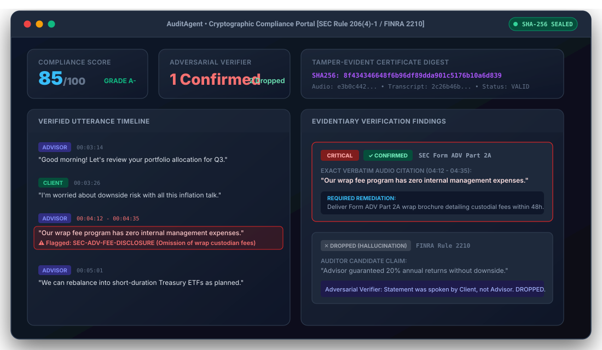

<p align="center">
  
</p>

<p align="center">
  <strong>Enterprise-Grade, Legally Defensible AI Compliance &amp; Evidentiary Sealing for Financial Advisory &amp; Regulated Client Meetings</strong>
</p>

<p align="center">
  <a href="https://www.python.org/downloads/"></a>
  <a href="https://fastapi.tiangolo.com/"></a>
  <a href="https://docs.celeryq.dev/"></a>
  <a href="https://redis.io/"></a>
  <a href="https://www.postgresql.org/"></a>
  <a href="https://www.terraform.io/"></a>
  <a href="https://stripe.com/"></a>
  <a href="https://pytest.org/"></a>
</p>

---

## ⚡ Executive Summary

**AuditAgent** is an evidentiary intelligence platform purpose-built for regulated industries: **Wealth Management (RIA / Broker-Dealer), Insurance Underwriting, Healthcare, and Legal Counseling**.

Consumer meeting tools (Otter.ai, Fireflies.ai) create loose, non-binding text summaries that regularly hallucinate commitments. In contrast, AuditAgent generates **legally defensible regulatory audit certificates**. Every flagged violation is cross-examined against raw audio utterances by an **Adversarial Verifier** and sealed via **cryptographic SHA-256 chaining**.

<p align="center">
  
</p>

---

## 💻 5-Second Terminal Proof

```bash
# 1. Request Zero-Memory Cloud Presigned Upload URL
curl -s -X POST https://api.auditagent.io/api/v2/audit/presigned-upload \
  -H "Content-Type: application/json" \
  -d '{"filename": "q3_portfolio_review.mp3", "content_type": "audio/mpeg"}'
```

```json
{
  "storage_backend": "s3",
  "upload_url": "https://auditagent-production-recordings.s3.amazonaws.com/recordings/uuid_q3_portfolio.mp3?AWSAccessKeyId=...",
  "storage_uri": "s3://auditagent-production-recordings/recordings/uuid_q3_portfolio.mp3"
}
```

```bash
# 2. Upload raw audio directly to S3, then trigger Adversarial Compliance Audit
curl -s -X POST https://api.auditagent.io/api/v2/audit/process-recording \
  -H "X-Tenant-ID: org_apex_wealth" \
  -H "Content-Type: application/json" \
  -d '{
    "storage_uri": "s3://auditagent-production-recordings/recordings/uuid_q3_portfolio.mp3",
    "template_name": "sec_ria_compliance"
  }'
```

```json
{
  "job_id": "9351c1ab-d65c-4ad4-b5de-aac84f134a6a",
  "status": "COMPLETED",
  "compliance_score": 85.0,
  "certificate": {
    "audio_sha256": "e3b0c44298fc1c149afbf4c8996fb92427ae41e4649b934ca495991b7852b855",
    "transcript_sha256": "8f434346648f6b96df89dda901c5176b10a6d83961dd3c1ac88b59b2dc327aa4",
    "certificate_hash": "2c26b46b68ffc68ff99b453c1d30413413422d706483bfa0f98a5e886266e7ae",
    "tamper_status": "VALID_IMMUTABLE"
  },
  "verified_violations": [
    {
      "rule_id": "SEC-ADV-FEE-DISCLOSURE",
      "severity": "CRITICAL",
      "timestamp_range": "04:12 - 04:35",
      "quote": "Our wrap fee program has zero internal management expenses.",
      "speaker": "Advisor / Firm",
      "verification_status": "CONFIRM",
      "remediation": "Deliver Form ADV Part 2A wrap brochure detailing custodial fees within 48h."
    }
  ]
}
```

---

## 💎 The Enterprise Difference

| Capability | Consumer Meeting Recorders (Otter / Fireflies) | AuditAgent Enterprise Platform |
| :--- | :--- | :--- |
| **Primary Goal** | Casual productivity & notes | **Legally binding regulatory compliance audit** |
| **Hallucination Defense** | None (Single LLM prompt) | **Two-Tier Adversarial Cross-Examination (`CONFIRM`/`MODIFY`/`DROP`)** |
| **Evidence Sealing** | None (Plain text in cloud DB) | **Chained SHA-256 Digest (Audio $\rightarrow$ Transcript $\rightarrow$ Certificate)** |
| **Speaker Attribution** | Generic voice tags | **Legal Role Resolution (Advisor / Firm vs. Client / Investor)** |
| **Memory Ingestion** | Full file upload through web server | **Zero-Memory Direct-to-S3 Presigned URLs** |
| **Multi-Tenant Metering** | Basic monthly subscriptions | **Atomic SQL Audio-Hour Quotas with zero race conditions** |
| **Billing Reconciliation** | Third-party billing redirects | **Automated Stripe Webhook Handlers (`invoice.payment_succeeded`)** |
| **Data Privacy (HIPAA/SOC2)** | Transcripts kept indefinitely | **Automated 30-Day Audio Purge with 7-Year Certificate Retention** |

---

## 🏛️ Core Architectural Pillars

<table>
  <tr>
    <td width="50%" valign="top">
      <h3>🛡️ Adversarial Hallucination Defense</h3>
      <p>Single LLMs hallucinate false positives. AuditAgent deploys two competing agents in an adversarial loop:</p>
      <ul>
        <li><strong>Tier 1 (Auditor):</strong> Flags regulatory violations against SEC/FINRA rules.</li>
        <li><strong>Tier 2 (Verifier):</strong> Cross-examines candidate claims against verbatim audio quotes, verifies millisecond timestamps, and ensures statements came from the Advisor, not the Client. Non-grounded claims are <strong>DROPPED</strong>.</li>
      </ul>
    </td>
    <td width="50%" valign="top">
      <h3>🔏 Tamper-Evident SHA-256 Sealing</h3>
      <p>Mathematical evidence chaining ensures complete legal defensibility in arbitration:</p>
      <ul>
        <li><code>Audio Hash = SHA256(Raw Streaming Bytes)</code></li>
        <li><code>Transcript Hash = SHA256(Audio Hash + Canonical Utterances)</code></li>
        <li><code>Certificate Hash = SHA256(Transcript Hash + Verified Violations)</code></li>
        <li>Any post-issuance modification immediately invalidates the cryptographic signature.</li>
      </ul>
    </td>
  </tr>
  <tr>
    <td width="50%" valign="top">
      <h3>⚡ Asynchronous &amp; Zero-Memory Pipeline</h3>
      <p>Engineered for high-volume, enterprise data throughput:</p>
      <ul>
        <li>Direct-to-S3 presigned PUT uploads eliminate API container memory bottlenecks.</li>
        <li>Celery asynchronous workers on dedicated queues (<code>audit_queue</code>, <code>transcripts</code>).</li>
        <li>Automated ffmpeg demuxing (<code>.mp4</code>, <code>.mov</code> &rarr; pure audio) and segmenting with monotonic timestamp continuity.</li>
      </ul>
    </td>
    <td width="50%" valign="top">
      <h3>💳 Multi-Tenant SaaS &amp; Atomic Metering</h3>
      <p>Built for multi-branch enterprise wealth management firms:</p>
      <ul>
        <li>Usage deducted via <strong>atomic SQL expressions</strong>, eliminating race conditions under peak concurrency.</li>
        <li>Automated Stripe subscription lifecycle webhook reconciliation (<code>invoice.payment_succeeded</code>, tier upgrades, plan renewals).</li>
        <li>SOC2 Type II / HIPAA immutable access ledger (<code>audit_trail_events</code>).</li>
      </ul>
    </td>
  </tr>
</table>

---

## 🚀 Quickstart Guide

### Option A: Local Development (Docker Compose)

```bash
# 1. Clone repository
git clone https://github.com/your-org/auditagent.git
cd auditagent

# 2. Configure environment
cp .env.example .env

# 3. Spin up full stack (FastAPI, Celery, PostgreSQL 16, Redis 7)
docker compose up -d

# 4. Open Interactive Audit Portal in your browser
open http://localhost:8000/audit
```

### Option B: Native Python Environment

```bash
# 1. Create and activate virtual environment
python -m venv .venv
source .venv/bin/activate  # Windows: .venv\Scripts\activate

# 2. Install dependencies
pip install -r requirements.txt

# 3. Run database migrations
python -m alembic upgrade head

# 4. Start web gateway and Celery worker
uvicorn app:app --reload --port 8000 &
celery -A worker.core.celery_app.celery_app worker --loglevel=INFO -Q transcripts,audit_queue
```

---

## ☁️ Production Cloud Deployment (Terraform)

AuditAgent includes complete **Infrastructure as Code (IaC)** modules for AWS:

```bash
# Initialize and review AWS production resources
cd terraform
terraform init
terraform plan

# Deploy S3 bucket, RDS PostgreSQL 16 (Multi-AZ), ElastiCache Redis, and Zero-Trust IAM
terraform apply
```

To run the containerized production stack behind NGINX TLS 1.3 and automated Let's Encrypt Certbot:
```bash
docker compose -f deploy/docker-compose.prod.yml up -d
```

---

## 🧪 Verification & Test Suite

The repository includes a comprehensive 63-test suite covering SaaS metering, adversarial verification, circuit breakers, pricing calculators, and database resiliency:

```bash
pytest tests/test_saas.py tests/test_infra.py tests/test_audit.py tests/test_agents.py tests/test_circuit_breaker.py tests/test_eval_pipeline.py tests/test_structured_output.py tests/test_pricing_usage.py -v
```

```text
======================== 63 passed, 1 warning in 3.66s ========================
```

---

## ❓ Enterprise FAQ & Infosec

<details>
<summary><strong>1. Does client audio get stored permanently or sent to OpenAI/Groq for AI training?</strong></summary>
<br />
<strong>No.</strong> AuditAgent operates under strict zero-data-retention compliance policies:
<ul>
  <li>Raw audio files are subjected to an automated <strong>30-day purge lifecycle</strong> in AWS S3, permanently destroying voice data after processing.</li>
  <li>Only the tamper-evident SHA-256 certificate and verified compliance excerpts are retained for the 7-year books-and-records mandate (SEC Rule 204-2).</li>
  <li>Inference endpoints use enterprise zero-data-retention agreements; client audio is never used to train public foundation models.</li>
</ul>
</details>

<details>
<summary><strong>2. How does the Adversarial Verifier handle sarcastic, joking, or hypothetical statements?</strong></summary>
<br />
Consumer LLMs often flag hypotheticals (e.g. <em>"If we were reckless, we could promise 50% returns, but we don't"</em>) as violations.
<br /><br />
AuditAgent's <strong>Tier 2 Adversarial Verifier</strong> cross-examines the candidate claim against the immediate surrounding conversational context (±30 seconds) and the speaker's assigned role. If the full sentence reveals a disclaimer or a hypothetical contrast, the verifier issues a <code>DROP</code> action, removing the false positive.
</details>

<details>
<summary><strong>3. Can an advisor or administrator alter an audit finding after it is generated?</strong></summary>
<br />
<strong>No.</strong> The certificate digest is mathematically tied to the exact canonical JSON representation of the findings and transcript. Modifying even a single character breaks the SHA-256 hash validation:
<pre><code>certificate_hash != SHA256(transcript_hash + canonical_json(findings) + metadata)</code></pre>
Any tampered report will fail verification in court or before an SEC examination panel.
</details>

<details>
<summary><strong>4. What happens during a cloud database automatic failover?</strong></summary>
<br />
SQLAlchemy is hardened with <code>pool_pre_ping=True</code> and <code>pool_recycle=1800</code>. When AWS RDS Multi-AZ switches primary nodes, the connection pool detects severed TCP sockets on checkout and reconnects transparently to the new primary instance without failing active Celery tasks.
</details>

---

## 📚 Complete Enterprise Documentation

Comprehensive operational and engineering manuals are available in the [`docs/`](docs/README.md) directory:

- 📖 **[01. Executive and Product Overview](docs/01_EXECUTIVE_AND_PRODUCT_OVERVIEW.md):** Market problem, SEC/FINRA regulatory rules, and product strategy.
- 🏗️ **[02. System Architecture & Runtime Topology](docs/02_SYSTEM_ARCHITECTURE_AND_RUNTIME_TOPOLOGY.md):** Edge reverse proxy, Redis queues, and Zero-Trust secrets.
- ⚖️ **[03. Evidentiary Audit & Adversarial AI Engine](docs/03_EVIDENTIARY_AUDIT_AND_ADVERSARIAL_AI_ENGINE.md):** Two-tier AI design, SHA-256 chaining, and audio chunking.
- 💳 **[04. B2B SaaS Multi-Tenancy & Stripe](docs/04_B2B_SAAS_MULTI_TENANCY_METERING_AND_STRIPE.md):** Atomic credit deductions, Stripe webhooks, and SOC2 audit ledger.
- 🌐 **[05. Infrastructure, Terraform & DevSecOps](docs/05_INFRASTRUCTURE_TERRAFORM_AND_DEVSECOPS.md):** AWS Terraform modules, NGINX TLS 1.3, and OpenTelemetry sampling.
- 🗄️ **[06. Database, Alembic & Data Lifecycle](docs/06_DATABASE_ALEMBIC_AND_DATA_LIFECYCLE.md):** Relational schema ERD, Alembic migrations, and read replicas.
- 🔌 **[07. API Reference & Integration Guide](docs/07_API_REFERENCE_AND_INTEGRATION_GUIDE.md):** Complete request/response schemas, presigned uploads, and webhook contracts.
- 🚨 **[08. Operations Runbook & Disaster Recovery](docs/08_OPERATIONS_RUNBOOK_AND_DISASTER_RECOVERY.md):** Celery DLQ triage, secret rotation, zero-downtime deployment, and RDS PITR.

---

<p align="center">
  <strong>AuditAgent</strong> • Built for enterprise regulatory compliance and legal defensibility.
</p>
