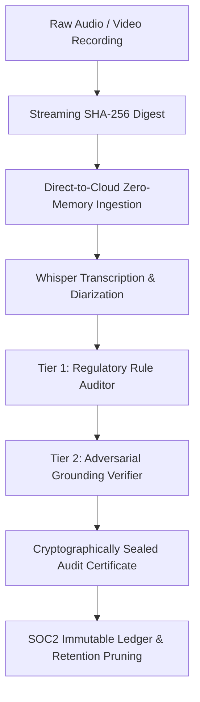

# 01. Executive and Product Overview

## Executive Summary
**AuditAgent (Meeting Automation MVP)** is an enterprise-grade AI compliance and evidentiary intelligence platform designed for highly regulated industries, including **Wealth Management, Financial Advisory (RIA / Broker-Dealer), Insurance Underwriting, and Legal Counseling**.

Unlike consumer meeting summarization tools (such as Otter.ai or Fireflies.ai) that focus on informal conversational summaries and frequently hallucinate commitments, AuditAgent provides **deterministic, legally defensible compliance audit trails**. Every regulatory claim or violation detected by the AI is cryptographically bound, cross-examined by an adversarial verifier, and sealed using SHA-256 cryptographic digests.

---

## The Core Problem Space

High-liability client communications face severe regulatory scrutiny under governing bodies such as the **SEC (Securities and Exchange Commission), FINRA, and state insurance commissioners**:

1. **Unsubstantiated Performance Claims:** Advisors guaranteeing returns or downplaying investment downside risk (violating SEC Rule 206(4)-1 and FINRA Rule 2210).
2. **Hidden or Incomplete Fee Disclosures:** Omitting advisory fees, wrap fees, custodial markups, or expense ratios during sales presentations (SEC Form ADV Part 2A enforcement).
3. **Suitability & Best Interest (Reg BI):** Recommending volatile securities or annuities without establishing client risk tolerance, liquidity needs, or time horizon.
4. **Consumer AI Hallucination Risk:** Standard LLMs invent commitments, fabricate quotes, and miss subtle regulatory omissions. In a regulatory investigation or FINRA arbitration, a non-grounded AI summary is legally useless.

---

## How AuditAgent Solves This

### Key Capabilities
- **Two-Tier Adversarial AI Architecture:** A primary auditor detects potential regulatory infractions, while a secondary adversarial verifier independently inspects raw audio timestamps and verbatim quotes to confirm, modify, or reject claims.
- **Cryptographic Evidence Sealing:** The raw audio file, timestamped transcript, and generated audit report are hashed into an immutable SHA-256 chain. Any tampering with report findings invalidates the cryptographic certificate.
- **Enterprise Multi-Tenancy & Atomic Metering:** Multi-tenant organization isolation with atomic SQL credit deductions, protecting against concurrent usage race conditions.
- **Automated Stripe Subscription Billing:** Webhook reconciliation for recurring billing, automatic usage resets, and plan upgrades.
- **Privacy & Compliance Lifecycle (SOC2 / HIPAA):** Automated 30-day audio purge policies remove high-liability raw voice recordings from cloud storage while permanently preserving compliance certificates for 7-year regulatory retention mandates.

---

## Product Architecture Evolution

| Dimension | Legacy Synchronous MVP | Production Enterprise Platform |
| :--- | :--- | :--- |
| **Execution Model** | Single-threaded blocking `/process` HTTP request | Decoupled asynchronous Celery workers backed by Redis |
| **Evidentiary Rigor** | Basic text summarization via single prompt | Two-tier Auditor $\rightarrow$ Adversarial Verifier with quote matching |
| **Tamper Resistance** | None (plain text output) | Streaming SHA-256 cryptographic certificate chaining |
| **File Storage** | Uploaded into memory and local server disk | Zero-memory presigned direct-to-S3/GCS cloud upload |
| **Multi-Tenancy** | Single shared database | B2B Organization isolation with atomic credit metering |
| **Billing & Payments** | None | Cryptographically verified Stripe webhook subscription lifecycle |
| **Infrastructure** | Manual local python execution | Modular Terraform IaC, Docker Compose, NGINX TLS 1.3, Certbot |
| **Database Migrations**| Ad-hoc table creation | Tracked Alembic migrations with pre-boot container execution |

