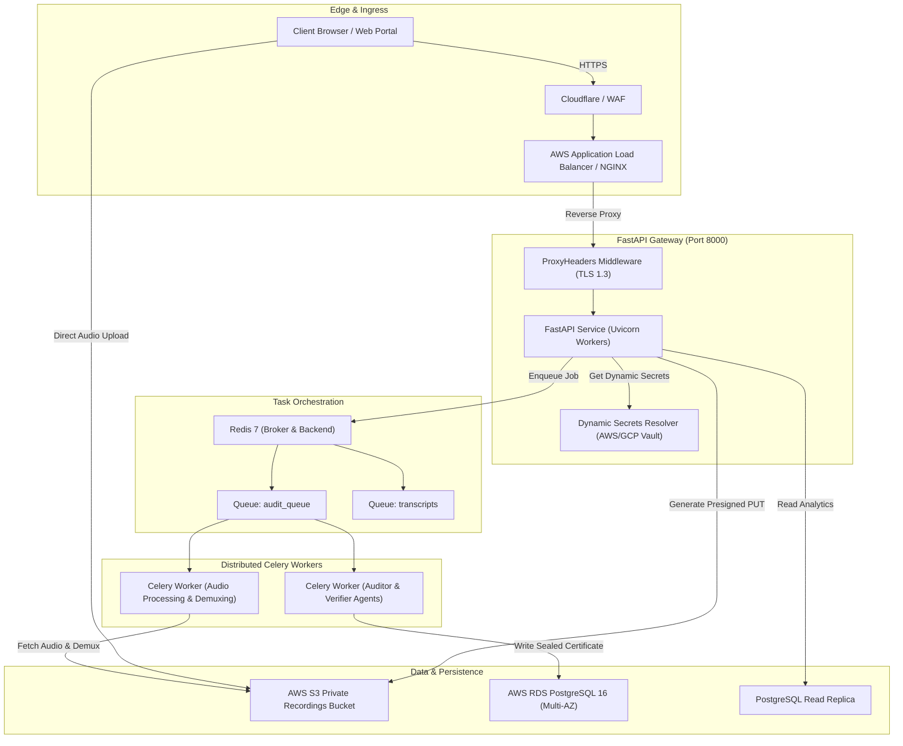

# 02. System Architecture and Runtime Topology

## High-Level Topology

The system separates synchronous client-facing web traffic from asynchronous, high-compute transcription and compliance auditing tasks.

---

## Component Breakdown

### 1. Edge & Ingress Layer
- **Reverse Proxy:** NGINX 1.25 terminates TLS 1.3, enforces HTTP Strict Transport Security (`Strict-Transport-Security: max-age=31536000`), and blocks cross-origin framing (`X-Frame-Options: DENY`).
- **Rate Limiting:** Enforced at the ingress layer (`100r/m` per client IP with burst buffers) to protect endpoints from brute-force authentication and denial-of-service attempts.
- **ACME Certbot Integration:** Automated Let's Encrypt certificate renewal via HTTP-01 challenge routing (`/.well-known/acme-challenge/`).

### 2. FastAPI Gateway (`app.py` & `worker/audit/api/`)
- **Proxy Headers Integration:** Configured with `ProxyHeadersMiddleware(trusted_hosts=["*"])` so that `X-Forwarded-Proto` (HTTPS) and client remote IP addresses are faithfully preserved.
- **Zero-Memory Streaming Ingestion:** Audio files are never buffered in memory on the API web container. Clients request presigned URLs (`POST /api/v2/audit/presigned-upload`) and stream files directly to AWS S3.
- **Dynamic Secret Resolution (`secrets_resolver.py`):** On startup, secrets are resolved hierarchically:
  1. Operating System Environment / `.env`
  2. AWS Secrets Manager (cached in-memory with TTL)
  3. Google Cloud Secret Manager
  4. Application defaults

### 3. Task Orchestration & Queue Architecture (`worker/core/celery_app.py`)
- **Queue Separation:**
  - `audit_queue`: High-priority compliance tasks requiring heavy LLM adversarial verification.
  - `transcripts`: Legacy and lightweight transcript processing tasks.
- **Late Acknowledgement (`task_acks_late=True`):** Tasks are only acknowledged after successful execution. If a worker container crashes during processing, Redis re-queues the task for execution by an alternate healthy worker.
- **Dead-Letter Failure Alerting (`@task_failure.connect`):** When a task permanently exhausts its retry budget (`max_retries=3`), Celery automatically logs a structured JSON `CRITICAL_CELERY_TASK_FAILURE` incident and dispatches an immediate notification to Slack or PagerDuty.

### 4. Storage Architecture (`worker/services/storage/storage_manager.py`)
- **Zero-Trust IAM Cloud Roles:** Uses `get_s3_client()` to support IAM instance profiles, ECS Task Roles, and AWS EKS IRSA (IAM Roles for Service Accounts) without requiring hardcoded static API keys.
- **Deterministic Worker File Retrieval:** Workers resolve storage URIs (`s3://...` or `local://...`), download the required object to a local scratch path, process it, and guarantee disk unlinking in `finally` blocks.

### 5. Database Architecture (`worker/core/database.py`)
- **Resilient Connection Pooling:**
  - `pool_size = 20`: Baseline persistent connection pool.
  - `max_overflow = 30`: Burst capacity under peak ingestion.
  - `pool_recycle = 1800`: Recycles connections every 30 minutes to prevent firewall TCP socket drops.
  - `pool_pre_ping = True`: Tests connection health prior to checkout, transparently surviving AWS RDS Multi-AZ automatic failovers without dropping worker tasks.
- **Read Replica Splitting:** Read-heavy reporting queries route to `get_read_db()`, preventing analytical queries from locking transactional write tables.

