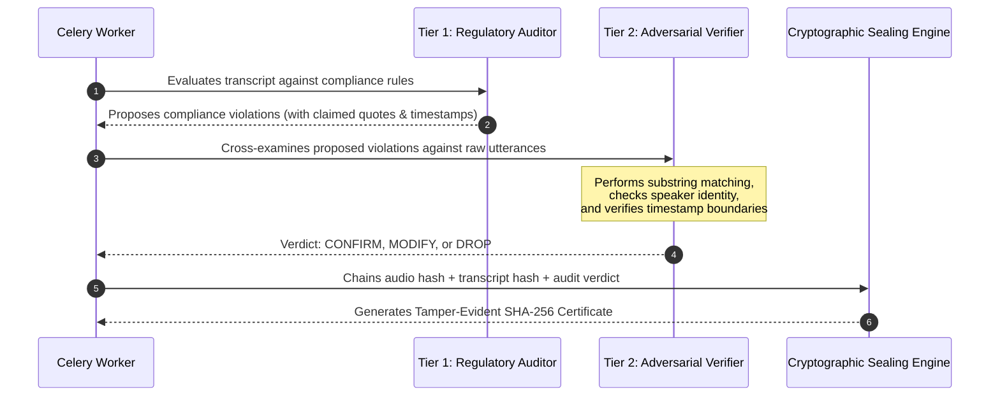

# 03. Evidentiary Audit and Adversarial AI Engine

## Overview
The evidentiary engine converts messy, conversational client meetings into **tamper-evident, mathematically verified regulatory compliance audits**. It eliminates AI hallucination through an **adversarial cross-examination pipeline**.

---

## The Two-Tier Adversarial AI Architecture

Standard single-pass LLM evaluations suffer from false positives (inventing violations that never occurred) and false negatives (missing implicit omissions). AuditAgent deploys two independent, specialized agents working in an adversarial loop:



### Tier 1: The Regulatory Auditor (`worker/audit/agents/auditor.py`)
- Evaluates meeting transcripts against industry-standard compliance rule templates:
  - **SEC Rule 206(4)-1:** Prohibiting performance guarantees and unsubstantiated claims.
  - **FINRA Rule 2210:** Ensuring communications are fair, balanced, and present balanced risk disclosures.
  - **SEC Reg BI (Best Interest):** Detecting ungrounded product recommendations lacking client suitability checks.
  - **Form ADV Part 2A:** Flagging failure to disclose management fees, wrap fees, and custodian costs.
- Generates a candidate list of non-compliant claims, each with an identified rule ID, severity score, claimed timestamp range, and claimed excerpt.

### Tier 2: The Adversarial Verifier (`worker/audit/agents/verifier.py`)
The Verifier acts as an independent compliance defense judge. It assumes the Auditor may be hallucinating and rigorously cross-examines every candidate claim against the raw audio utterances:

1. **Substring Quote Grounding:**
   - The claimed quote must exist verbatim in the audio transcript text (normalized for whitespace and punctuation).
   - If the quote does not appear in the transcript, the claim is immediately flagged as a hallucination and **DROPPED**.
2. **Timestamp Bounding:**
   - Verifies that the claimed quote occurred within the specified `start_time` and `end_time` boundaries.
   - Adjusts jittered or misaligned timestamps to the exact millisecond boundaries of the audio segment.
3. **Speaker Identity Attribution:**
   - Evaluates whether the offending statement was actually spoken by the **Advisor / Firm Representative**, rather than the **Client**. If a client says *"I want 20% guaranteed returns"*, it is not an advisor compliance violation.
4. **Final Action State Machine:**
   - `CONFIRM`: The claim is 100% grounded, verbatim, accurately attributed, and retained.
   - `MODIFY`: The quote is present but timestamps or minor wording need alignment.
   - `DROP`: The quote was fabricated or misattributed; removed from the final report.

---

## Cryptographic Evidence Sealing (`worker/audit/workflows/audit_workflow.py`)

To ensure evidentiary admissibility in regulatory arbitration or legal proceedings, AuditAgent implements a **tamper-evident SHA-256 hash chain**:

```
Audio File Hash       = SHA256(Raw Audio File Bytes via 64KB Chunk Buffer)
Transcript Hash       = SHA256(Audio Hash + Canonical JSON(Utterances))
Compliance Cert Hash  = SHA256(Transcript Hash + Canonical JSON(Verified Violations) + Metadata)
```

- **Tamper Evidence:** If any party modifies a single character of the transcript, changes an attributed speaker, or removes a violation from the audit report, the recalculated SHA-256 digest fails validation against the certificate signature.
- **Streaming Buffer Hashing:** Audio files are digested in streaming $64\text{KB}$ memory buffers, preventing memory exhaustion when hashing large multi-gigabyte meeting recordings.

---

## Audio Preprocessing & Chunking Pipeline (`worker/audit/services/audio.py`)

Long meetings and multi-media containers require specialized preprocessing before Whisper transcription:

1. **Video Demuxing:** Files with extensions `.mp4`, `.mov`, `.webm` are automatically demuxed via `ffmpeg` to extract pure mono audio streams (`-vn -ac 1 -c:a libmp3lame`), reducing bandwidth and avoiding codec errors.
2. **Deterministic Chunking:** Audio files exceeding $24\text{MB}$ are split into continuous $20$-minute chunks with an overlap buffer.
3. **Monotonic Timestamp Offsets:** Each chunk is transcribed with an added baseline offset (`chunk_index * chunk_duration_seconds`), ensuring timestamps remain perfectly monotonic across hour-long recordings.
4. **Worker Disk Sanitation:** All split audio slices are tracked in a managed array and deleted from worker disk in a guaranteed `finally` cleanup block upon task completion or failure.

