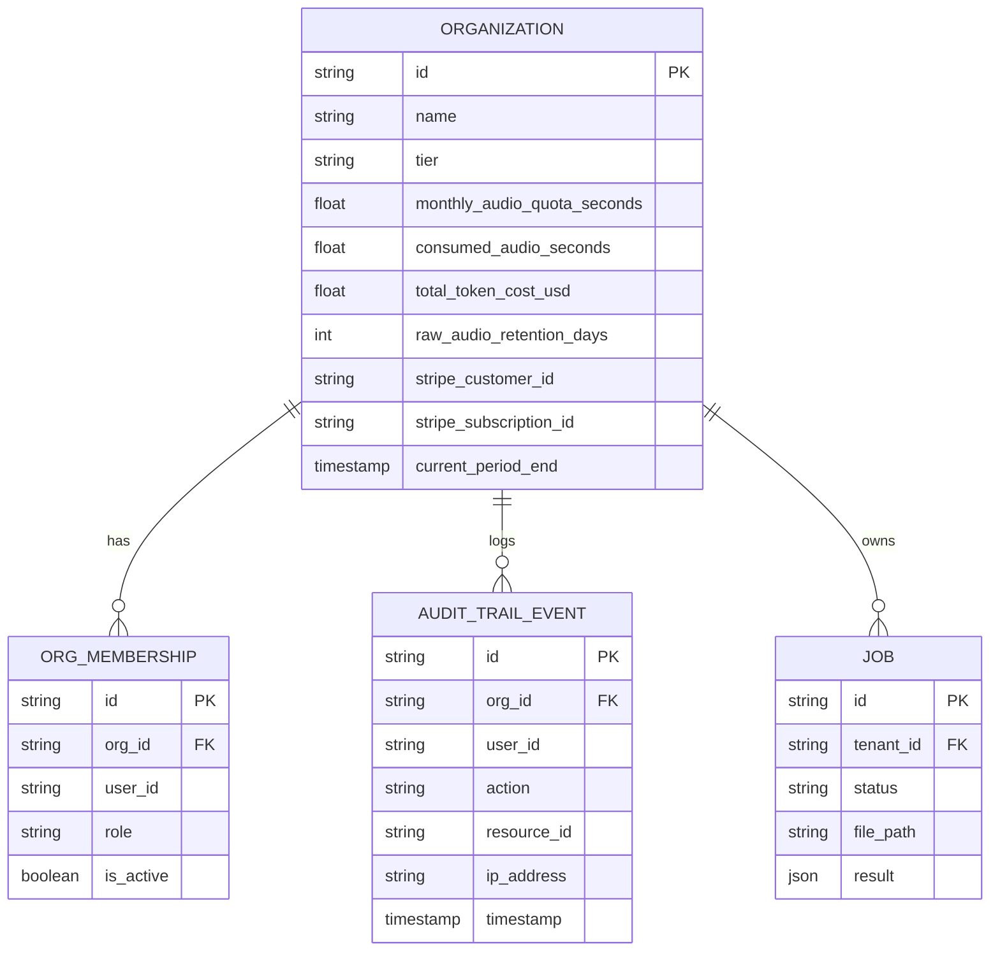

# 04. B2B SaaS Multi-Tenancy, Metering and Stripe Integration

## Tenant Isolation Model

AuditAgent is engineered as an enterprise multi-tenant platform where every data asset is scoped to an **Organization**.



### Role-Based Access Control (RBAC)
- `ORG_OWNER`: Administrative account management, Stripe subscription control, team provisioning.
- `COMPLIANCE_DIRECTOR`: Full access to compliance audit certificates, template customization, and retention policies.
- `AUDITOR`: Day-to-day meeting inspection, report exportation, and claim review.
- `MEMBER`: Read-only access to assigned client meeting transcripts.

---

## Atomic Credit Metering (`worker/saas/services/metering.py`)

### The Concurrency Problem
In high-volume enterprise environments, multiple financial advisors from the same organization submit recordings simultaneously. Standard read-modify-write patterns:
```python
# VULNERABLE: Causes race conditions and under-billing under concurrency
org.consumed_audio_seconds += actual_audio_seconds
db.commit()
```
Worker A and Worker B read the same balance, overwriting each other's increments and resulting in severe quota under-reporting.

### The Solution: Atomic SQL Increments
AuditAgent executes atomic, database-level increment expressions:
```python
db.query(Organization).filter(Organization.id == org_id).update({
    Organization.consumed_audio_seconds: Organization.consumed_audio_seconds + actual_audio_seconds,
    Organization.total_token_cost_usd: Organization.total_token_cost_usd + token_cost_usd
})
db.commit()
```
The database engine serializes the arithmetic operation at the row level, guaranteeing that 100 concurrent uploads from the same firm are metered accurately with zero credit loss.

---

## Stripe Webhook Integration (`worker/saas/api/endpoints.py`)

AuditAgent automates subscription lifecycles via direct Stripe integration:

- **Endpoint:** `POST /api/v2/saas/billing/webhook`
- **Cryptographic Signature Verification:** Evaluates `Stripe-Signature` using `STRIPE_WEBHOOK_SECRET` to protect against unauthorized spoofing.

### Handled Webhook Events

| Stripe Event | Application Action |
| :--- | :--- |
| `invoice.payment_succeeded` | Resets `consumed_audio_seconds = 0.0` and updates `current_period_end` to the next billing cycle. |
| `customer.subscription.created` | Provisions initial tier quota (`PILOT`: 10 hrs, `GROWTH`: 50 hrs, `ENTERPRISE`: 200 hrs). |
| `customer.subscription.updated` | Adjusts `monthly_audio_quota_seconds` when a tenant upgrades or downgrades their plan tier. |
| `customer.subscription.deleted` | Downgrades tenant to `CANCELED` status and suspends further audio processing. |

---

## SOC2 / HIPAA Immutable Audit Trail (`worker/saas/services/ledger.py`)

To satisfy SOC2 Type II Trust Criteria and HIPAA access accounting requirements:
- Every inspection of an audit report, export of a compliance certificate, or upload of audio is logged in `audit_trail_events`.
- Events capture: `org_id`, `user_id`, `action`, `resource_id`, `ip_address`, and `timestamp`.
- The audit ledger is **append-only**; the API exposes no update or delete routes on audit events.

---

## Automated 30-Day Privacy Retention Policy (`worker/saas/services/retention.py`)

Raw voice recordings represent significant legal and data-privacy liability. AuditAgent implements an automated two-stage data lifecycle:

1. **Raw Voice Data (30-Day Purge):** After 30 days (configurable per tenant), raw audio files in AWS S3 / local storage are permanently deleted.
2. **Compliance Certificates (7-Year Retention):** The SHA-256 hash certificate, speaker-attributed transcript excerpts, and compliance findings are preserved indefinitely to satisfy SEC Rule 204-2 (Books and Records) mandates.

