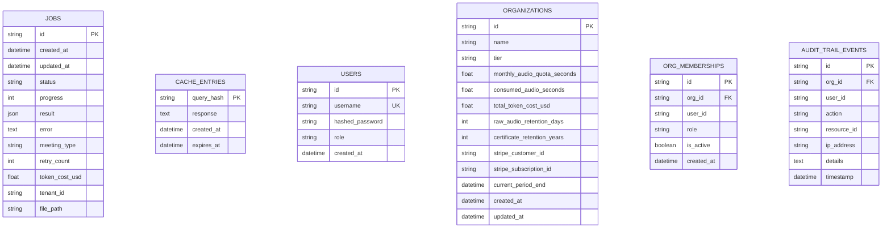

# 06. Database, Alembic and Data Lifecycle

## Schema Architecture & Relational Model

The persistence layer uses SQLAlchemy 2.0 with tracked migrations managed via **Alembic**.



---

## Alembic Migration Pipeline

AuditAgent tracks all schema revisions under `alembic/versions/`.

### Migration Commands

```bash
# Apply all pending migrations to the database
python -m alembic upgrade head

# Generate a new migration script based on detected SQLAlchemy model changes
python -m alembic revision --autogenerate -m "add_new_compliance_field"

# Roll back the most recent migration
python -m alembic downgrade -1

# View migration history and current head
python -m alembic history --verbose
python -m alembic current
```

### Pre-Boot Migration Hook (`entrypoint.sh`)
In production containers, database migrations run automatically prior to service startup:
```bash
#!/bin/bash
set -e
echo "[entrypoint] Running database migrations..."
python -m alembic upgrade head
echo "[entrypoint] Starting application process: $@"
exec "$@"
```
This guarantees that database schemas are synchronized before Uvicorn or Celery workers begin handling requests.

---

## Connection Pooling & Resiliency (`worker/core/database.py`)

To guarantee stability under heavy enterprise workloads and during cloud database failovers:

```python
_engine_kwargs["pool_size"] = 20        # Baseline active connections
_engine_kwargs["max_overflow"] = 30     # Burst connections during traffic spikes
_engine_kwargs["pool_recycle"] = 1800   # Recycle every 30m to avoid cloud firewall TCP drops
_engine_kwargs["pool_pre_ping"] = True  # Validates connection health before checkout
```

### How `pool_pre_ping` Prevents Downtime
During an AWS RDS Multi-AZ automatic failover, the primary database node switches IPs. Without `pool_pre_ping`, existing pooled connections encounter stale socket errors (`OperationalError: server closed the connection unexpectedly`). With `pool_pre_ping=True`, SQLAlchemy detects the severed socket immediately on checkout, drops the invalid connection, and reconnects transparently to the new primary node without crashing worker tasks.

---

## Read Replica Routing

To protect transactional write performance:
- **Write Operations (`get_db()`):** Route to `DATABASE_URL` (the primary writer node).
- **Analytical & Reporting Queries (`get_read_db()`):** Route to `DATABASE_READ_REPLICA_URL`. If no replica is configured, it falls back gracefully to the primary engine.

