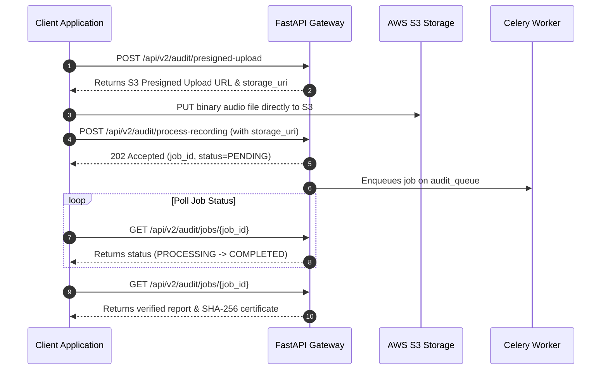

# 07. API Reference and Integration Guide

## Authentication
AuditAgent secures API access using JSON Web Tokens (JWT) passed in the `Authorization` header:
```http
Authorization: Bearer <your_jwt_token>
```
To obtain a token, authenticate via `POST /api/v1/auth/login`.

---

## End-to-End Compliance Audit Workflow



---

## Endpoint Reference

### 1. Generate Presigned Upload URL
Generates a direct-to-cloud presigned URL to stream audio without passing through API server memory.

- **URL:** `POST /api/v2/audit/presigned-upload`
- **Request Body:**
```json
{
  "filename": "q3_client_portfolio_review.mp3",
  "content_type": "audio/mpeg"
}
```
- **Response (`200 OK`):**
```json
{
  "storage_backend": "s3",
  "upload_url": "https://auditagent-production-recordings.s3.amazonaws.com/recordings/uuid_q3_client.mp3?AWSAccessKeyId=...",
  "storage_uri": "s3://auditagent-production-recordings/recordings/uuid_q3_client.mp3",
  "method": "PUT",
  "headers": {
    "Content-Type": "audio/mpeg"
  }
}
```

---

### 2. Enqueue Audit Recording
Submits a recording for transcription, speaker attribution, and two-tier adversarial compliance verification.

- **URL:** `POST /api/v2/audit/process-recording`
- **Headers:** `X-Tenant-ID: <org_id>`
- **Request Body:**
```json
{
  "storage_uri": "s3://auditagent-production-recordings/recordings/uuid_q3_client.mp3",
  "meeting_type": "financial_advisory",
  "template_name": "sec_ria_compliance"
}
```
- **Response (`202 Accepted`):**
```json
{
  "job_id": "9351c1ab-d65c-4ad4-b5de-aac84f134a6a",
  "status": "PENDING",
  "created_at": "2026-11-14T14:40:00Z"
}
```

---

### 3. Retrieve Audit Certificate & Report
Retrieves the cryptographically sealed compliance report and full speaker-attributed transcript.

- **URL:** `GET /api/v2/audit/jobs/{job_id}`
- **Response (`200 OK`):**
```json
{
  "job_id": "9351c1ab-d65c-4ad4-b5de-aac84f134a6a",
  "status": "COMPLETED",
  "meeting_type": "financial_advisory",
  "compliance_score": 85.0,
  "certificate": {
    "audio_sha256": "e3b0c44298fc1c149afbf4c8996fb92427ae41e4649b934ca495991b7852b855",
    "transcript_sha256": "8f434346648f6b96df89dda901c5176b10a6d83961dd3c1ac88b59b2dc327aa4",
    "certificate_hash": "2c26b46b68ffc68ff99b453c1d30413413422d706483bfa0f98a5e886266e7ae",
    "issued_at": "2026-11-14T14:42:15Z"
  },
  "verified_violations": [
    {
      "rule_id": "SEC-ADV-FEE-DISCLOSURE",
      "severity": "HIGH",
      "timestamp_range": "04:12 - 04:35",
      "quote": "Our wrap fee program has zero internal management expenses.",
      "speaker": "Advisor / Firm",
      "verification_status": "CONFIRM",
      "remediation": "Provide written ADV Part 2A wrap brochure disclosing custodial and underlying ETF expense ratios."
    }
  ]
}
```

---

### 4. Tenant Usage & Metering Analytics
Returns the organization's monthly audio quota consumption and LLM spend.

- **URL:** `GET /api/v2/saas/organizations/{org_id}/usage`
- **Response (`200 OK`):**
```json
{
  "org_id": "org-apex-wealth-01",
  "name": "Apex Wealth Partners",
  "tier": "GROWTH",
  "quota_hours": 50.0,
  "consumed_hours": 12.4,
  "remaining_hours": 37.6,
  "percent_used": 24.8,
  "total_token_cost_usd": 3.4215,
  "retention_policy_days": 30
}
```

---

### 5. Stripe Billing Webhook
Receives Stripe payment and subscription updates.

- **URL:** `POST /api/v2/saas/billing/webhook`
- **Headers:** `Stripe-Signature: t=...,v1=...`
- **Response (`200 OK`):**
```json
{
  "status": "success",
  "event": "invoice.payment_succeeded",
  "customer": "cus_12345"
}
```

