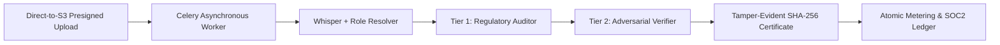

# AuditAgent (Meeting Automation MVP) - Enterprise Documentation Index

Welcome to the comprehensive technical documentation for **AuditAgent**, an enterprise-grade AI compliance, transcription, and evidentiary audit platform designed for regulated industries (Wealth Management, Financial Advisory, Insurance, and Legal Counseling).

---

## Documentation Directory

| Manual | Document | Focus & Scope |
| :---: | :--- | :--- |
| **01** | [01. Executive and Product Overview](01_EXECUTIVE_AND_PRODUCT_OVERVIEW.md) | Problem space, regulatory compliance (SEC/FINRA), product mission, and architectural evolution. |
| **02** | [02. System Architecture & Runtime Topology](02_SYSTEM_ARCHITECTURE_AND_RUNTIME_TOPOLOGY.md) | Edge ingress, FastAPI gateways, Redis/Celery queue topology, zero-trust secrets, and storage routing. |
| **03** | [03. Evidentiary Audit & Adversarial AI Engine](03_EVIDENTIARY_AUDIT_AND_ADVERSARIAL_AI_ENGINE.md) | Two-tier Auditor $\rightarrow$ Adversarial Verifier, SHA-256 cryptographic chaining, and audio chunking. |
| **04** | [04. B2B SaaS Multi-Tenancy & Stripe](04_B2B_SAAS_MULTI_TENANCY_METERING_AND_STRIPE.md) | Multi-tenant isolation, atomic credit deductions, Stripe webhook reconciliation, and SOC2 audit ledger. |
| **05** | [05. Infrastructure, Terraform & DevSecOps](05_INFRASTRUCTURE_TERRAFORM_AND_DEVSECOPS.md) | AWS Terraform modules (S3, RDS, Redis, IAM), NGINX TLS 1.3, Certbot, and OpenTelemetry sampling. |
| **06** | [06. Database, Alembic & Data Lifecycle](06_DATABASE_ALEMBIC_AND_DATA_LIFECYCLE.md) | Relational ERD models, Alembic migrations, connection pool tuning, and read replica splitting. |
| **07** | [07. API Reference & Integration Guide](07_API_REFERENCE_AND_INTEGRATION_GUIDE.md) | Authentication, presigned uploads, job enqueuing, report retrieval, and webhook integration. |
| **08** | [08. Operations Runbook & Disaster Recovery](08_OPERATIONS_RUNBOOK_AND_DISASTER_RECOVERY.md) | Incident response, Celery DLQ triage, secret rotation, zero-downtime deployment, and RDS PITR. |

---

## Architectural Highlights at a Glance

- **Legally Defensible Evidentiary Rigor:** Adversarial cross-examination of compliance violations against verbatim quotes and timestamp boundaries.
- **Cryptographic Chaining:** Chained SHA-256 digests mathematically guarantee that audio, transcript, and compliance certificates cannot be modified post-issuance.
- **Race-Condition-Proof Metering:** Multi-tenant quota deductions execute via atomic SQL updates (`consumed_audio_seconds = consumed_audio_seconds + :delta`).
- **Cloud-Native Zero-Trust:** Dynamic secret loading via AWS Secrets Manager / GCP Secret Manager and IAM Pod Identity fallback.

