# Architecture Diagrams

Comprehensive visual representations of the system derived from the actual codebase.

---

## 1. System Context Diagram

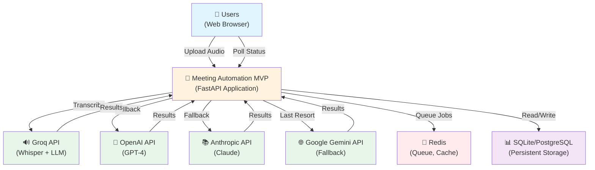

### How to Read This Diagram

- **Blue (Users)**: Real people using the system via web browser
- **Orange (App)**: Core application (what we're studying)
- **Green (APIs)**: External LLM services (Groq, OpenAI, Anthropic, Gemini)
- **Red (Redis)**: In-memory cache and job queue
- **Purple (Database)**: Persistent data storage

### Important Observations

1. **Multi-Provider LLM**: Observable - System calls 4 different LLM APIs, not just one
2. **Clear Boundaries**: Observable - Application is the bridge between users and external services
3. **Two Data Stores**: Observable - Redis (ephemeral) and database (persistent)
4. **No Direct Browser-to-API**: Observable - All external API calls go through application (security boundary)

### Questions I Should Ask Myself

- [ ] Why doesn't the user talk directly to Groq API?
- [ ] What happens if Redis crashes? Does the system still work?
- [ ] What happens if all 4 LLM providers are down?
- [ ] Why are there 4 LLM providers instead of just 1?
- [ ] Does the user ever see Redis or database directly?

---

## 2. Container Diagram

```mermaid
graph TB
    Browser["🌐 Web Browser<br/>(User Interface)"]
    
    subgraph "FastAPI Web Application"
        Routes["📍 API Routes<br/>(jobs, auth)")
        Auth["🔐 Authentication<br/>(JWT, Password)"]
        RateLimit["⏱️ Rate Limiting<br/>(Token Bucket)"]
        Middleware["📊 Middleware<br/>(Logging, Tracing)"]
    end
    
    subgraph "Celery Worker (Background Processing)"
        Workflow["⚙️ Workflow Orchestrator<br/>(Main Pipeline)"]
        Transcriber["🎙️ Transcriber<br/>(Groq Whisper)"]
        Extractor["🔍 LLM Extractor<br/>(Multi-provider)"]
        Evaluator["⭐ Evaluator<br/>(Metrics + Judge)"]
        RAG["🔎 RAG Pipeline<br/>(Retrieve Context)"]
    end
    
    subgraph "Services"
        LLMRouter["🤖 LLM Router<br/>(Failover Logic)"]
        Cache["⚡ Semantic Cache<br/>(Vector Similarity)"]
        Embeddings["📈 Embeddings<br/>(Vectors)"]
    end
    
    subgraph "Data Stores"
        Redis["🔴 Redis<br/>(Queue, Cache)"]
        Database["💾 Database<br/>(Jobs, Users)"]
    end
    
    subgraph "External Services"
        Groq["🔊 Groq API"]
        OpenAI["🤖 OpenAI API"]
        Anthropic["📚 Anthropic API"]
        Gemini["🌐 Gemini API"]
    end
    
    Browser -->|HTTP/HTTPS| Routes
    Routes --> Auth
    Routes --> RateLimit
    Routes --> Middleware
    Routes -->|Enqueue Job| Redis
    
    Redis -->|Dequeue| Workflow
    Workflow --> Transcriber
    Transcriber --> Groq
    Workflow --> Cache
    Cache --> Embeddings
    Workflow --> Extractor
    Extractor --> LLMRouter
    LLMRouter --> Groq
    LLMRouter --> OpenAI
    LLMRouter --> Anthropic
    LLMRouter --> Gemini
    Workflow --> Evaluator
    Workflow --> RAG
    Workflow -->|Write Results| Database
    
    Routes -->|Query| Database
    Auth -->|Query Users| Database
    
    style Browser fill:#e1f5ff
    style Routes fill:#fff3e0
    style Auth fill:#fff3e0
    style RateLimit fill:#fff3e0
    style Middleware fill:#fff3e0
    style Workflow fill:#ffe0b2
    style Transcriber fill:#ffe0b2
    style Extractor fill:#ffe0b2
    style Evaluator fill:#ffe0b2
    style RAG fill:#ffe0b2
    style LLMRouter fill:#f8bbd0
    style Cache fill:#f8bbd0
    style Embeddings fill:#f8bbd0
    style Redis fill:#ffebee
    style Database fill:#f3e5f5
    style Groq fill:#c8e6c9
    style OpenAI fill:#c8e6c9
    style Anthropic fill:#c8e6c9
    style Gemini fill:#c8e6c9
```

### How to Read This Diagram

- **Blue**: User interface (browser)
- **Orange**: Web application layer (request handling)
- **Light Orange**: Celery worker layer (background processing)
- **Pink**: Services (business logic)
- **Red**: Redis (ephemeral storage)
- **Purple**: Database (persistent storage)
- **Green**: External LLM APIs

### Important Observations

1. **Layered Architecture**: Observable - Web layer separate from worker layer
2. **Service Layer**: Observable - LLMRouter, Cache, Embeddings are shared services
3. **Async Processing**: Observable - Jobs enqueued to Redis, processed in background
4. **Multiple Processing Stages**: Observable - Transcribe → Extract → Evaluate → RAG
5. **Fallback Chain**: Observable - LLMRouter tries Groq → OpenAI → Anthropic → Gemini

### Questions I Should Ask Myself

- [ ] Can the web layer and worker layer run on different machines?
- [ ] Why is there a separate Transcriber and Extractor?
- [ ] Where does RAG get used if it's in the workflow?
- [ ] What happens to data in Redis if it crashes?
- [ ] Why is Cache a separate service from the workflow?

---

## 3. Component Diagram: LLM Service

```mermaid
graph TB
    Router["🚪 LLM Router<br/>(Main Entry Point)"]
    
    subgraph "Circuit Breaker Pattern"
        CB["Circuit Breaker<br/>(CLOSED/OPEN/HALF_OPEN)"]
    end
    
    subgraph "Providers"
        Groq["🔊 Groq Provider<br/>(Fast, Cheap)"]
        OpenAI["🤖 OpenAI Provider<br/>(Reliable)"]
        Anthropic["📚 Anthropic Provider<br/>(Quality)"]
        Gemini["🌐 Gemini Provider<br/>(Fallback)"]
    end
    
    subgraph "Cross-Cutting"
        Pricing["💰 Pricing Service<br/>(Cost Estimation)"]
        Usage["📊 Usage Service<br/>(Token Tracking)"]
    end
    
    Router -->|query()| CB
    CB -->|Try| Groq
    CB -->|Fallback| OpenAI
    CB -->|Fallback| Anthropic
    CB -->|Last Resort| Gemini
    Groq --> Pricing
    OpenAI --> Pricing
    Anthropic --> Pricing
    Gemini --> Pricing
    Groq --> Usage
    OpenAI --> Usage
    Anthropic --> Usage
    Gemini --> Usage
    
    style Router fill:#fff3e0
    style CB fill:#ffccbc
    style Groq fill:#c8e6c9
    style OpenAI fill:#c8e6c9
    style Anthropic fill:#c8e6c9
    style Gemini fill:#c8e6c9
    style Pricing fill:#f8bbd0
    style Usage fill:#f8bbd0
```

### How to Read This Diagram

- **Orange**: Main router interface
- **Salmon**: Circuit breaker (fault tolerance)
- **Green**: LLM provider implementations
- **Pink**: Cross-cutting services (pricing, usage)

### Important Observations

1. **Strategy Pattern**: Observable - Each provider is a strategy, router selects which to use
2. **Circuit Breaker**: Observable - Prevents hammering failed providers
3. **Fallback Order**: Observable - Groq (cost) → OpenAI (reliability) → Anthropic (quality) → Gemini (free)
4. **Cost Tracking**: Observable - Pricing and usage services track spend
5. **Transparent Failover**: Observable - Caller doesn't know which provider succeeded

### Questions I Should Ask Myself

- [ ] What's the difference between Groq and OpenAI providers?
- [ ] Why is circuit breaker in a separate component?
- [ ] How does the router know which provider to try first?
- [ ] What happens if Groq is OPEN and OpenAI is also OPEN?
- [ ] How are costs calculated for each provider?

---

## 4. Component Diagram: Evaluation Pipeline

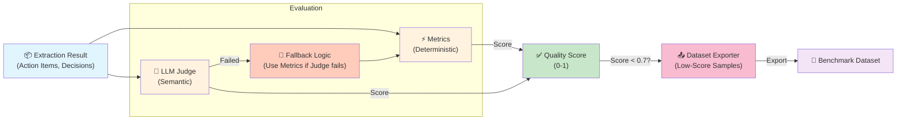

### How to Read This Diagram

- **Blue**: Input extraction result
- **Orange**: Evaluation components
- **Salmon**: Graceful fallback
- **Green**: Output quality score
- **Pink**: Export functionality
- **Purple**: Benchmark database

### Important Observations

1. **Dual Assessment**: Observable - Both deterministic and semantic scoring
2. **Graceful Degradation**: Observable - Falls back to metrics if LLM judge fails
3. **Threshold-Based Export**: Observable - Only export low-scoring samples (< 0.7)
4. **Continuous Improvement**: Observable - Exported data enables model improvement
5. **No Hard Failures**: Observable - System returns score even if judge fails

### Questions I Should Ask Myself

- [ ] Why both metrics and judge? Why not just one?
- [ ] What's the difference between metrics (deterministic) and judge (LLM)?
- [ ] What happens if both metrics and judge fail?
- [ ] How often should the benchmark dataset be reviewed?
- [ ] Why export only low-scoring samples, not all results?

---

## 5. Component Diagram: RAG Pipeline

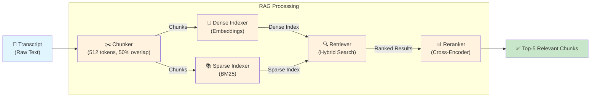

### How to Read This Diagram

- **Blue**: Input transcript
- **Orange**: RAG processing steps
- **Green**: Output (relevant chunks)

### Important Observations

1. **Overlapping Chunks**: Observable - 50% overlap prevents losing context at boundaries
2. **Dual Indexing**: Observable - Both semantic (embeddings) and lexical (BM25) search
3. **Hybrid Retrieval**: Observable - Combines dense and sparse results
4. **Reranking**: Observable - Cross-encoder refines top results
5. **Optional Flow**: Observable - Used when extraction confidence is low

### Questions I Should Ask Myself

- [ ] Why use 512 tokens per chunk?
- [ ] Why 50% overlap?
- [ ] What's the difference between dense and sparse search?
- [ ] Why rerank after retrieval?
- [ ] When is RAG invoked vs. when is it skipped?

---

## 6. Component Diagram: Agent Extraction

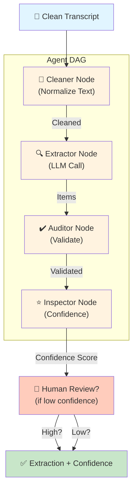

### How to Read This Diagram

- **Blue**: Input transcript
- **Orange**: Processing nodes
- **Salmon**: Human-in-the-loop decision point
- **Green**: Output

### Important Observations

1. **DAG Executor**: Observable - Nodes run in dependency order
2. **Mutable State**: Observable - State object passes through pipeline
3. **Human-in-Loop**: Observable - Low confidence triggers manual review flag
4. **Quality Assurance**: Observable - Auditor validates extracted data
5. **Confidence Scoring**: Observable - Inspector calculates confidence

### Questions I Should Ask Myself

- [ ] What does the Cleaner node remove?
- [ ] How does Auditor validate consistency?
- [ ] What confidence score triggers human review?
- [ ] What happens if a node fails?
- [ ] Can nodes run in parallel?

---

## 7. Dependency Diagram

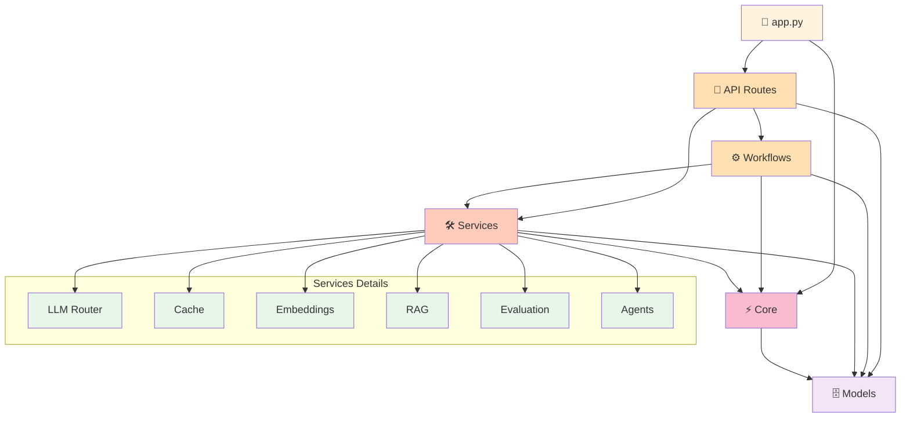

### How to Read This Diagram

- Arrows show dependencies (A → B means A depends on B)
- Everything depends on Core (infrastructure)
- Everything depends on Models (data models)
- Workflows orchestrate Services

### Important Observations

1. **Core at Bottom**: Observable - Infrastructure (database, security, telemetry) is foundational
2. **Models are Shared**: Observable - All layers use same ORM models
3. **Services Layer**: Observable - Business logic abstracted in services
4. **Routes Thin**: Observable - Routes just call services and workflows
5. **No Circular Dependencies**: Observable - Clean layering (no cycles)

### Questions I Should Ask Myself

- [ ] Why does everything depend on Core?
- [ ] Can you use Models without Routes?
- [ ] What would happen if Core had a bug?
- [ ] How would you test Services independently?
- [ ] Why not put everything in one file?

---

## 8. Request Lifecycle Diagram

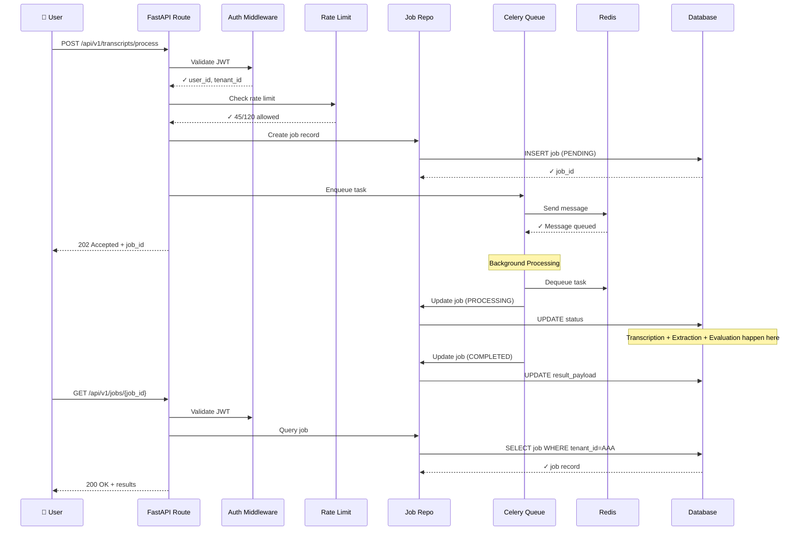

### How to Read This Diagram

- Time flows top to bottom
- Horizontal lines show messages between components
- Solid lines = synchronous, dashed = asynchronous
- Note box marks transition to background processing

### Important Observations

1. **Immediate Response**: Observable - FastAPI returns 202 before job completes
2. **Tenant Scoping**: Observable - Every query includes tenant filter
3. **Persistent Queue**: Observable - Messages go to Redis (survives restart)
4. **Status Polling**: Observable - Client polls /jobs/{job_id} to get results
5. **Async Processing**: Observable - Real work happens after HTTP response

### Questions I Should Ask Myself

- [ ] What happens if user loses JWT between POST and GET?
- [ ] Why not return results immediately instead of 202?
- [ ] What if job fails during processing?
- [ ] How does rate limit reset after a minute?
- [ ] Where is tenant_id used to prevent data leaks?

---

## 9. Authentication Flow Diagram

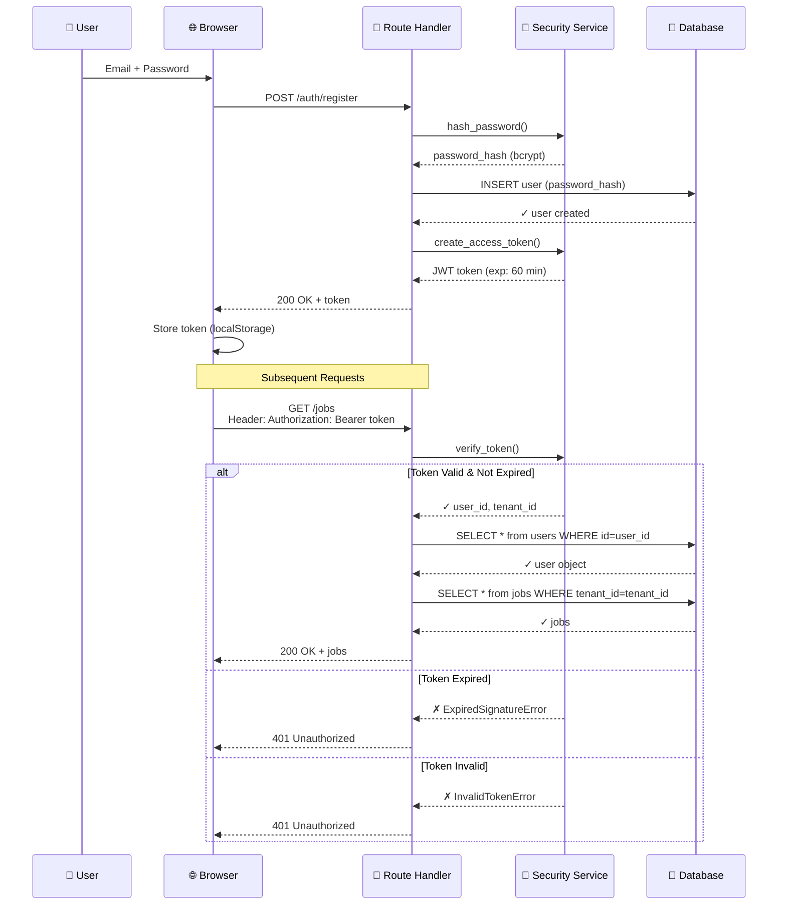

### How to Read This Diagram

- **Top section**: Registration flow (one-time)
- **Bottom section**: Authentication flow (every request)
- **Alt boxes**: Conditional branches (success vs. error)

### Important Observations

1. **Stateless Authentication**: Observable - JWT doesn't require server session
2. **Password Hashing**: Observable - Bcrypt used, never stored plain text
3. **Token in Header**: Observable - Follows standard (Authorization: Bearer token)
4. **Expiration**: Observable - Token expires after 60 minutes
5. **Tenant Extraction**: Observable - tenant_id embedded in token

### Questions I Should Ask Myself

- [ ] Where is SECRET_KEY used?
- [ ] How does token signature verification work?
- [ ] What if token is stolen?
- [ ] Why 60 minutes for expiration?
- [ ] How does tenant_id prevent cross-tenant access?

---

## 10. Database ER Diagram

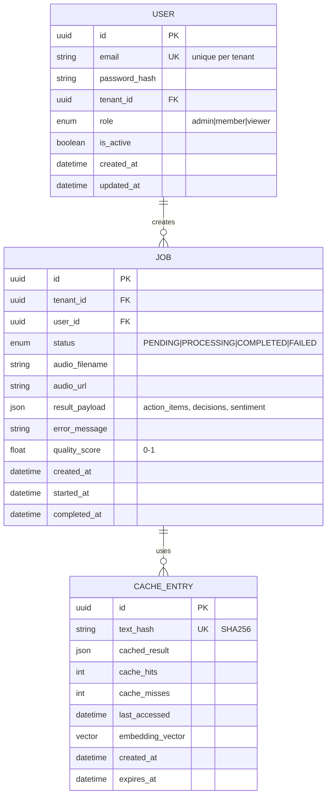

### How to Read This Diagram

- **PK**: Primary Key (unique identifier)
- **FK**: Foreign Key (reference to another table)
- **UK**: Unique Key (must be unique)
- **||**: One-to-many relationship
- **o{**: Zero or many

### Important Observations

1. **Email Unique Per Tenant**: Observable - `(email, tenant_id)` composite unique key
2. **No Global User Table**: Observable - Multi-tenancy at DB layer
3. **Status Enum**: Observable - Prevents invalid states (typos)
4. **Soft Deletes**: Observable - `is_active` flag instead of DELETE
5. **JSON Payload**: Observable - Flexible schema for extraction results

### Questions I Should Ask Yourself

- [ ] Why is `(email, tenant_id)` a unique pair, not just `email`?
- [ ] What's the relationship between user_id and tenant_id in JOB?
- [ ] Why store embeddings in database if they're in cache?
- [ ] How are old cache entries cleaned up?
- [ ] What if quality_score calculation fails?

---

## 11. Data Flow Diagram

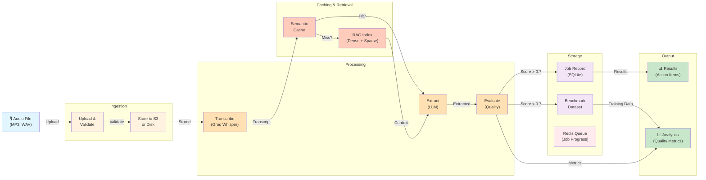

### How to Read This Diagram

- Flows left to right (data movement)
- Box shapes show processing steps
- Color groups show related components

### Important Observations

1. **Multiple Entry Points**: Observable - Data can hit cache or go to RAG
2. **Quality-Based Branching**: Observable - Good results go to production, bad to benchmark
3. **Feedback Loop**: Observable - Benchmark data improves future models
4. **Caching Optimization**: Observable - Avoid expensive transcription/extraction
5. **Persistent vs. Ephemeral**: Observable - Database (persistent), Redis (ephemeral)

### Questions I Should Ask Myself

- [ ] What happens to audio file after processing?
- [ ] How long is data kept in cache vs. database?
- [ ] How often is benchmark dataset reviewed?
- [ ] What prevents cache poisoning (bad cached results)?
- [ ] How does RAG know what context to retrieve?

---

## 12. Authentication & Authorization Flow

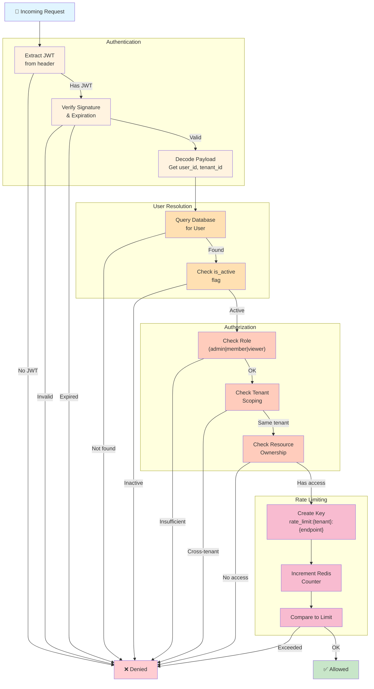

### How to Read This Diagram

- Flows top to bottom
- Orange boxes: Authentication (Who are you?)
- Salmon boxes: Authorization (What can you do?)
- Pink boxes: Rate limiting (How much can you do?)
- Green/Red: Success/Failure

### Important Observations

1. **Layered Security**: Observable - Multiple checks before resource access
2. **JWT Verification First**: Observable - Invalid token rejected immediately
3. **Tenant Scoping**: Observable - Checked at multiple levels
4. **Rate Limiting Last**: Observable - Only counted for allowed requests
5. **Fail-Safe**: Observable - Any check failure = access denied

### Questions I Should Ask Myself

- [ ] Why verify JWT signature if we can decode it anyway?
- [ ] What's the difference between invalid and expired tokens?
- [ ] Why check is_active and role separately?
- [ ] How does resource ownership check work?
- [ ] Why is tenant check separate from role check?

---

## 13. Deployment Architecture (Unknown/Assumed)

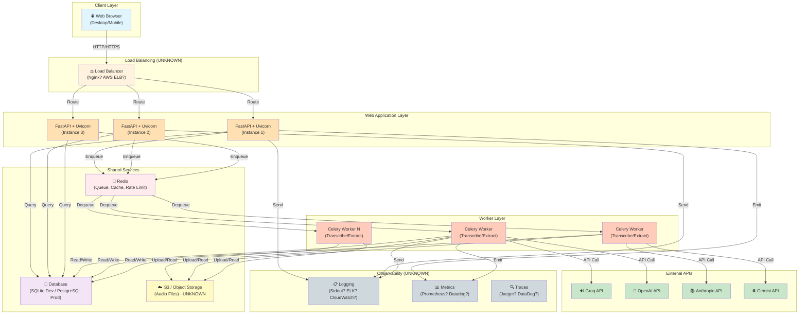

### How to Read This Diagram

- **Blue**: Users
- **Orange**: Load balancer (unknown if exists)
- **Light Orange**: Web instances (stateless)
- **Salmon**: Worker instances (stateless, scale independently)
- **Red**: Redis (shared, must not fail)
- **Purple**: Database (shared, must not fail)
- **Yellow**: Object storage (unknown if used)
- **Gray**: Observability (unknown details)

### Important Observations

1. **Stateless Design**: Observable - Web and worker instances are interchangeable
2. **Horizontal Scaling**: Observable - Add more FastAPI/worker instances
3. **Shared State**: Observable - Redis and database are central bottlenecks
4. **Unknown Architecture**: [Assumed] Load balancing, object storage, observability not shown in code
5. **CI/CD Unknown**: [Assumed] No deployment automation in repository

### Questions I Should Ask Myself

- [ ] How many FastAPI instances do you need?
- [ ] How many workers should you run?
- [ ] What happens if Redis crashes?
- [ ] What happens if database crashes?
- [ ] How do you monitor this in production?
- [ ] How do you deploy new code?
- [ ] How do you scale if traffic doubles?
- [ ] Is there a disaster recovery plan?

---

## 14. Multi-Tenancy Isolation Diagram

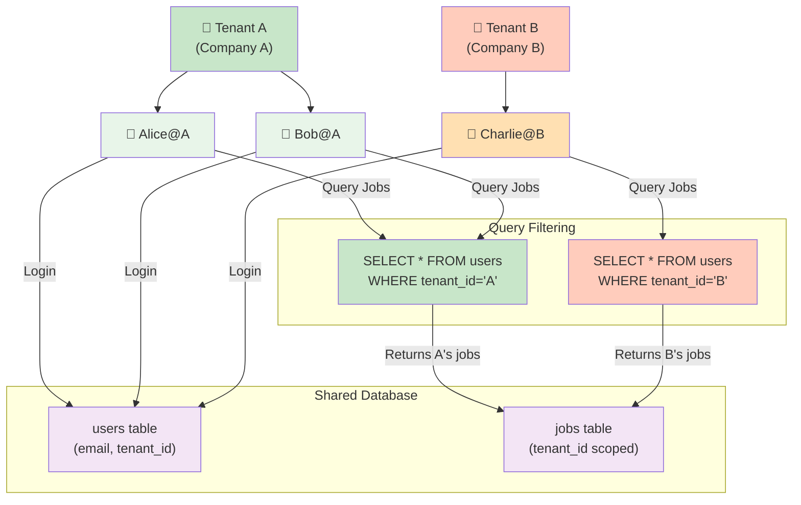

### How to Read This Diagram

- Green: Tenant A's data and users
- Orange: Tenant B's data and users
- Purple: Shared database (single instance, but logically isolated)

### Important Observations

1. **Single Database**: Observable - Both tenants share one database
2. **Query-Level Filtering**: Observable - Every query filters by tenant_id
3. **No Cross-Contamination**: Observable - Queries from A never return B's data
4. **Same Email OK**: Observable - Alice@example.com can exist in A and B
5. **Complete Isolation**: Observable - Rate limits, permissions, all per-tenant

### Questions I Should Ask Myself

- [ ] What happens if a query forgets to filter by tenant_id?
- [ ] How does tenant_id get into every query?
- [ ] What if user credentials are stolen?
- [ ] Can admins of Tenant A see Tenant B's data?
- [ ] How do you test multi-tenancy isolation?

---

## 15. Scaling Scenarios Diagram

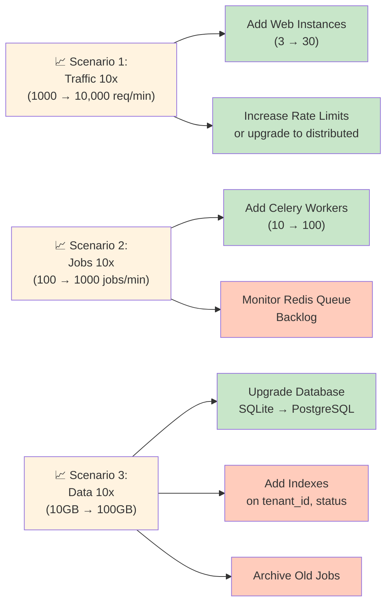

### How to Read This Diagram

- Each scenario shows a bottleneck
- Connected boxes show solutions
- Green: Solution, Orange: May need attention

### Important Observations

1. **Horizontal Scaling**: Observable - Add instances for web and worker layers
2. **Rate Limiting Bottleneck**: Observable - Per-tenant limits may need rethinking at scale
3. **Queue Management**: Observable - Monitor Redis queue depth
4. **Database Scaling**: Observable - SQLite insufficient at scale
5. **Data Retention**: Observable - Old data should be archived

---

## Summary: Key Architectural Insights from Diagrams

| Insight | Evidence | Implication |
|---------|----------|-------------|
| **Async First** | Workflow diagram shows Celery workers | Scales to high concurrency |
| **Multi-Provider LLM** | LLM Router has 4 providers | Resilient to single provider failure |
| **Multi-Tenancy Built-In** | Every query filters by tenant_id | Can serve multiple organizations |
| **Layered Architecture** | Separate Web, Worker, Service layers | Independent scaling |
| **Fail-Safe Defaults** | Circuit breaker, rate limiting, tenant filtering | Unlikely to leak data or crash |
| **Quality Assurance** | Dual evaluation (metrics + judge) | Catches problems early |
| **Semantic Caching** | Cache layer before expensive operations | Reduces API costs |
| **No Global State** | All instances stateless | Easy to scale |

---

**Next Step**: Use these diagrams to navigate the code. When you find a component, reference the relevant diagram to understand its context.
